# InvestingView

**A self-hosted investment dashboard for portfolio tracking, chart analysis, and market research.**

InvestingView brings holdings, cash balances, transaction history, technical scanners,
earnings research, and market-moving news into one responsive workspace. It pairs a
Python/Flask backend with a lightweight JavaScript frontend and a persistent SQLite
database, packaged as a single Docker service.

[Quick start](#quick-start) · [Features](#features) · [Screenshots](#screenshots) · [Documentation](#documentation) · [Development](#development)

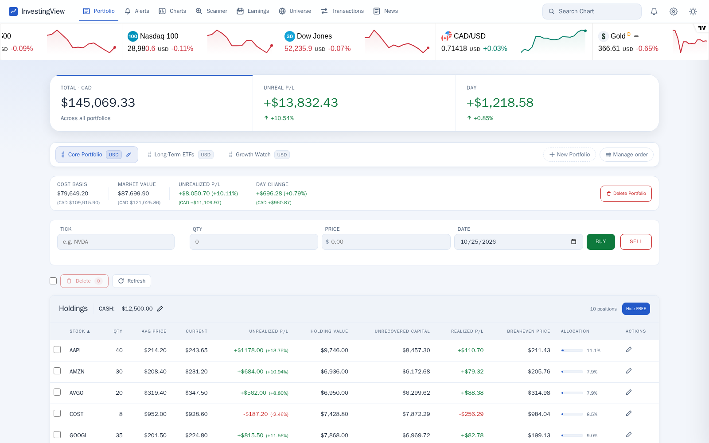

*Demonstration portfolios and investment figures are synthetic. See the
[screenshot notes](docs/screenshots/README.md) for capture details.*

## Features

### Portfolio and transaction tracking

- **Multiple portfolios:** create, rename, reorder, and manage USD or CAD portfolios.
- **Holdings and cash:** record buys and partial or full sells, edit positions, move
  holdings between portfolios, and maintain a cash balance for each portfolio.
- **Performance at a glance:** cost basis, market value, daily change, unrealized
  P/L, allocation, and recorded P/L history, with CAD-converted overview figures.
- **Position-level insight:** unrecovered capital, realized P/L for the current
  holding cycle, and the remaining position's cash breakeven price.
- **Transaction analysis:** a paginated ledger, realized P/L by ticker and by sale,
  best/worst sale snapshots, monthly P/L, and a calendar of trading activity.

### Charting and research

- **A shared expanded chart:** open symbols from across the app or use the global
  ticker search; switch between the chart and recent ticker news.
- **Technical overlays:** candlesticks, volume, a 200-day moving average,
  support/resistance drawings, earnings markers, and detected pattern overlays.
- **Holding-aware charts:** average purchase price, transaction markers,
  position P/L, and portfolio-specific trailing-stop tracking.
- **Chart workspaces:** custom ticker tabs plus derived Holdings, Earnings,
  200 SMA, and Live Chart views.
- **Intraday and embedded views:** Yahoo price streaming delivered through
  server-sent events, plus an optional TradingView chart widget.
- **Desktop analysis tools:** volume profile with selectable ranges and an anchor,
  and trailing-stop setup. Existing stop lines remain visible on mobile.

### Scanners, earnings, and market context

- **Nine scanner panels:** Momentum, Reversal, 200 SMA, YTD Return, Earnings,
  Quality Score, Swing, Trade, and ETF Holdings.
- **Persistent rankings:** qualification streaks, rank movement, and historical
  views for YTD returns and Trend Quality scores.
- **Earnings Watchlist:** upcoming announcements, ten-session return tiles,
  relative strength against SPY, and an explainable signed momentum score.
- **ETF holdings:** issuer-published top holdings for XDIV.TO, SPY, QQQ, SOXX,
  ARKK, DYNF, and DIVO, including published weights, share quantities, rank changes,
  and dated history.
- **Alerts and watchlists:** price thresholds, drawn support/resistance checks,
  average-price crosses, trailing-stop events, and notification history, with
  Discord and Gmail delivery for supported scheduled checks.
- **News and market ticker:** a saved movers digest, on-demand ticker headlines,
  and a configurable TradingView quote strip with per-device instrument selection.

The interface supports light and dark themes, responsive desktop/mobile layouts,
and home-screen installation through its web app manifest and service worker.

## Screenshots

### Mobile

<p>
  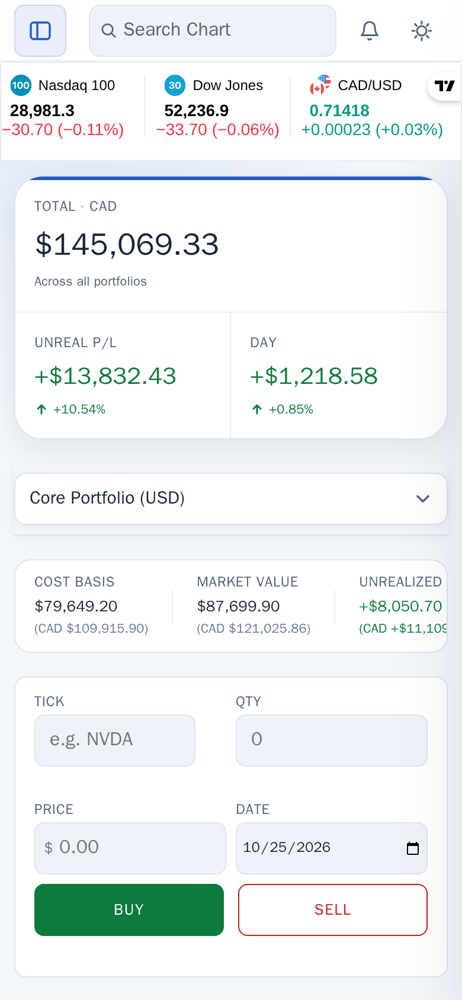
  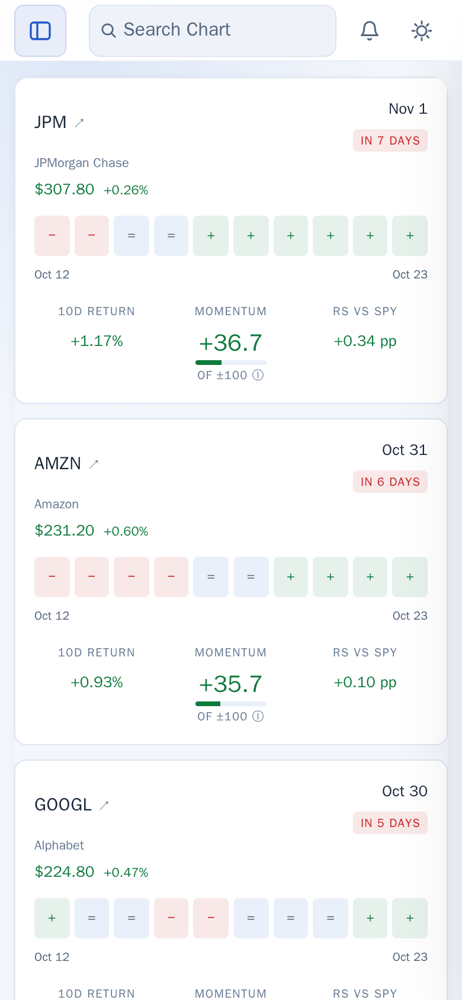
  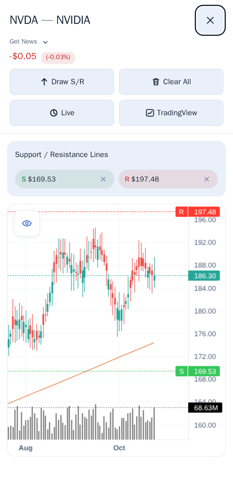
</p>

<details>
<summary>Desktop research and transaction views</summary>

**Stock Scanner**

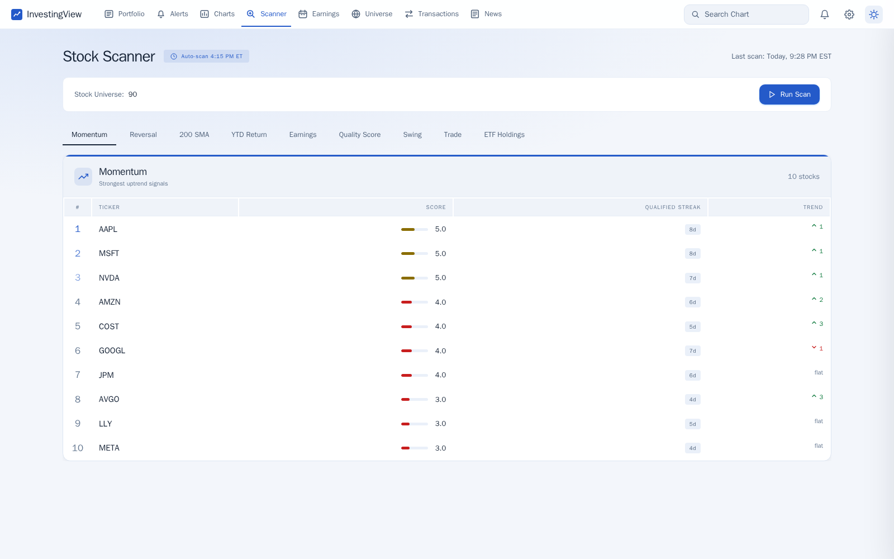

**Earnings Watchlist**

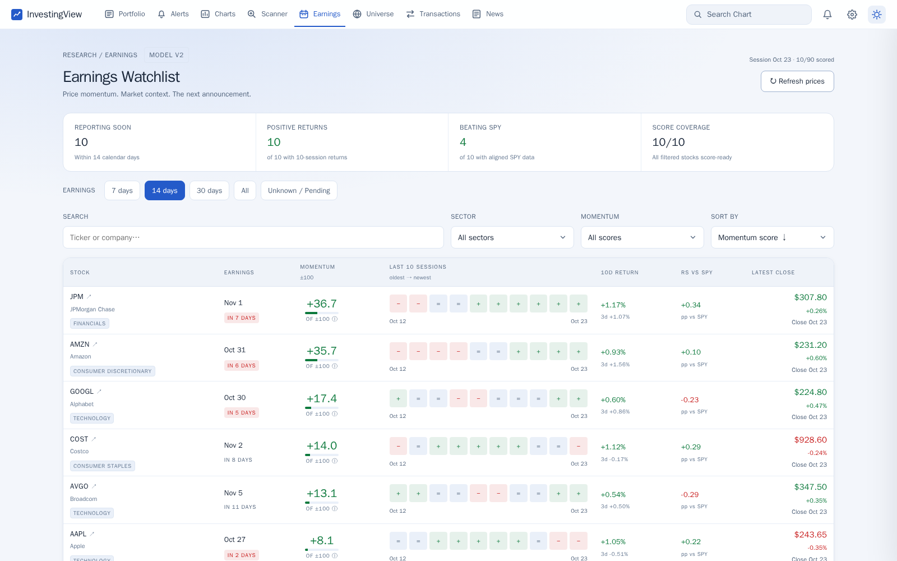

**Expanded chart**

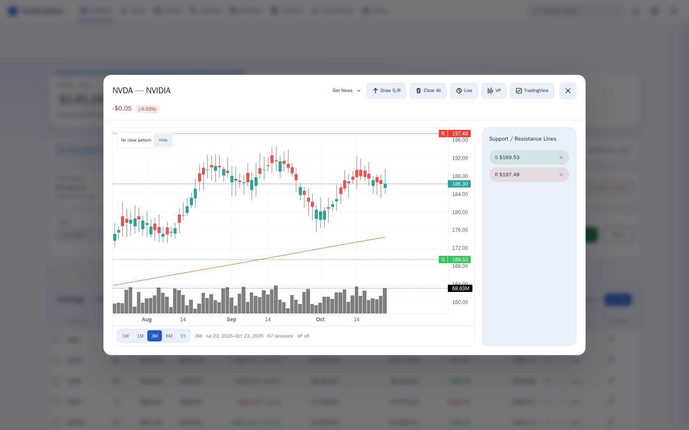

**Transactions**

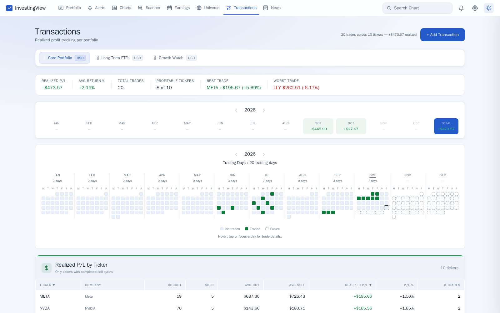

</details>

<details>
<summary>Dark theme and additional mobile views</summary>

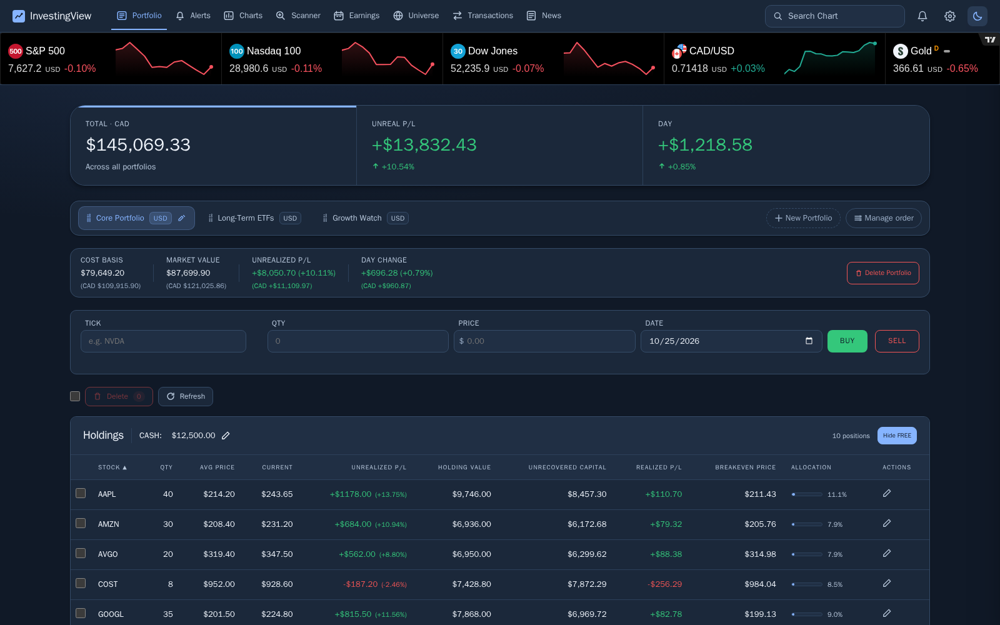

<p>
  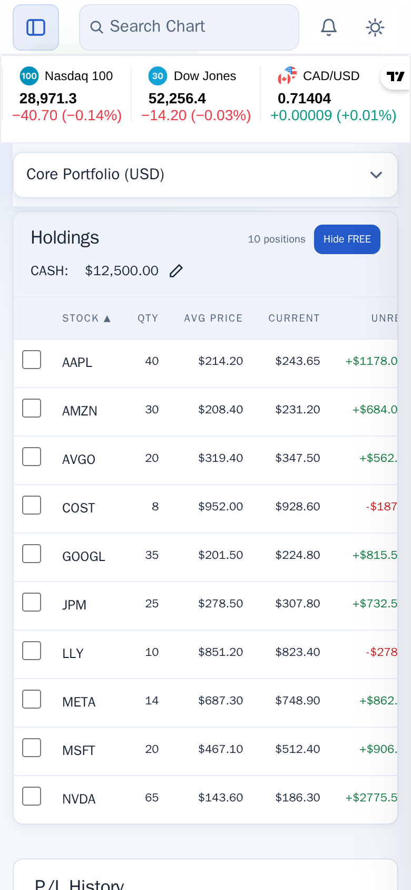
  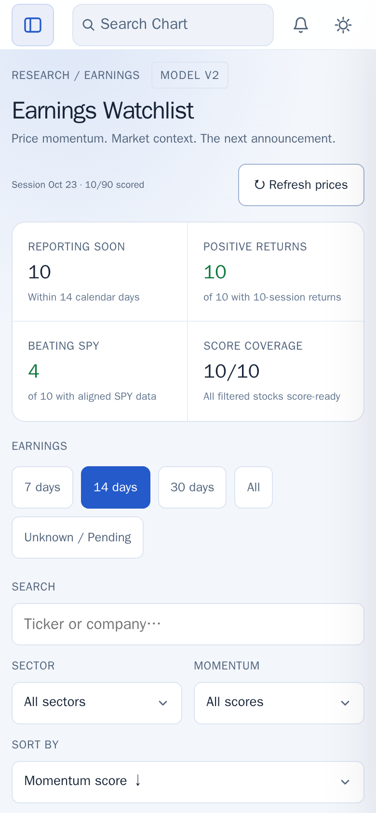
  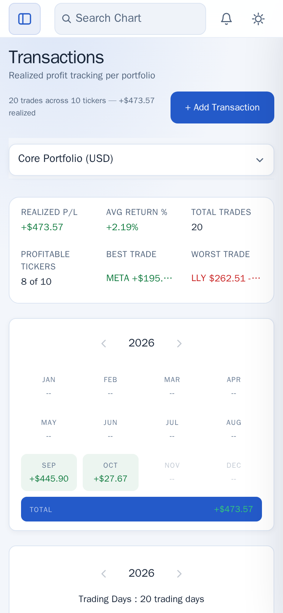
</p>

</details>

## Quick start

### Docker Compose

Install [Docker Engine](https://docs.docker.com/engine/install/) and the
[Docker Compose plugin](https://docs.docker.com/compose/install/), then run the
following from the repository root:

```bash
docker compose up -d --build
docker compose logs -f investingview
```

Open **<http://localhost:9000>** once startup finishes. The first run initializes
the database, seeds the default stock universe, and attempts initial market-data
and earnings fetches. Those requests can take several minutes. The initial
dashboard price fetch is skipped on weekends; some research views may remain
empty until a weekday refresh.

```bash
# Check the HTTP service
curl http://localhost:9000/api/health

# Stop the service; bind-mounted data remains on disk
docker compose down
```

Compose persists the database under `./data` and mounts `./logs` for application
log files. No market-data API key or `.env` file is needed for the default setup.
Configure optional notification credentials through **Settings** in the app.

The current runtime is intended for single-user use in a trusted environment.
It has no built-in login, and the supplied entry point enables Flask debug mode.
See [runtime and deployment details](docs/operations.md#runtime-and-network-access)
before choosing how to expose an instance.

### Run locally

Requires **Python 3.11+**, `pip`, and virtual-environment support. There is no Node.js
dependency or frontend build step.

```bash
# Run from the repository root
python3 -m venv venv
source venv/bin/activate
python -m pip install -r backend/requirements.txt
python backend/app.py
```

Open <http://localhost:9000>. On Windows, activate the environment with
`venv\Scripts\activate` instead. The default local database path is
`data/investingview.db`, relative to the working directory.

### First steps

1. Create a portfolio and choose its currency.
2. Set its cash balance and record holdings using the Portfolio **BUY** / **SELL**
   controls. These actions also create ledger entries.
3. Open a holding or search for a symbol to inspect its chart.
4. Explore the scanner panels and filter the Earnings Watchlist.
5. Open **Settings** using the gear icon to configure notifications and the
   market ticker. Screens are selected in the app; Settings is not a separate
   `/settings` page.

See the [usage guide](docs/usage.md) for cost-basis behavior, scanner explanations,
and alert timing.

## Architecture

```text
Browser: HTML / CSS / JavaScript modules
    │
    ├── JSON requests ──────────── Flask blueprints
    └── EventSource stream ────── Live-price service
                                      │
                                Domain services ◀── APScheduler
                                      ├── SQLite (persistent data, WAL mode)
                                      └── Yahoo Finance / news / ETF issuers

Browser embeds: TradingView widgets and CDN-loaded chart library
```

| Layer | Technologies |
| --- | --- |
| Backend | Python, Flask, Flask-CORS |
| Frontend | HTML, CSS, vanilla JavaScript, ES modules |
| Charts | TradingView Lightweight Charts, TradingView embeds |
| Storage | SQLite with write-ahead logging and startup migrations |
| Market data and analysis | yfinance, pandas, NumPy |
| Scheduling and notifications | APScheduler, Discord webhooks, Gmail SMTP |
| Packaging | Docker and Docker Compose |

Flask serves both the API and frontend. Background jobs run in the application
process; SQLite stores portfolios, trades, settings, cached market data, and
research history. See [development and API notes](docs/development.md) for the
code layout and request flow.

## Documentation

| Guide | Contents |
| --- | --- |
| [Using InvestingView](docs/usage.md) | Portfolio workflows, P/L definitions, charts, scanners, earnings, alerts, and news |
| [Running and maintaining an instance](docs/operations.md) | Configuration, persistence, backups, updates, scheduled jobs, troubleshooting, and isolated previews |
| [Development and API notes](docs/development.md) | Architecture, source layout, startup lifecycle, representative endpoints, testing, and contributions |
| [Screenshot notes](docs/screenshots/README.md) | Synthetic data, viewport sizes, and capture isolation |

## Development

After installing the application dependencies, install `pytest` separately:

```bash
python -m pip install pytest

# Use a disposable database, independent of a local application's data
DATABASE_PATH="$(mktemp -d)/investingview-tests.db" \
  PYTHONPATH=backend python -m pytest backend/tests -q
```

The command above uses a POSIX shell. Existing tests cover alert evaluation,
ETF holdings ingestion/history, trading activity, and trailing-stop behavior.
Some route tests can exercise provider lookups; see the
[testing notes](docs/development.md#tests).

Bug reports and focused pull requests are welcome. Include reproduction steps
for issues and verification details for changes; the
[contribution notes](docs/development.md#contributing) describe the project
conventions.

## Data and project scope

InvestingView records and analyzes investments entered by the user. It does not
connect to a brokerage account or execute orders. Trailing stops are tracked
conditions and notifications, not broker-held orders.

Market-data freshness depends on the provider, caches, market hours, and the
refresh schedule. The embedded TradingView ticker is independent of the prices
used to value holdings. Earnings momentum and Trend Quality are research scores,
not predictions of earnings results or future returns. The web app caches its
static interface; market data and API-backed features still require a connection
to the server.

## Acknowledgments

- [yfinance](https://github.com/ranaroussi/yfinance) for Yahoo Finance data access.
- [TradingView Lightweight Charts](https://github.com/tradingview/lightweight-charts)
  and [TradingView widgets](https://www.tradingview.com/widget/) for charting and
  embedded market views.
- Google News RSS for headline discovery, and the respective ETF issuers for
  published holdings data.

## License

Licensed under the [MIT License](LICENSE).
